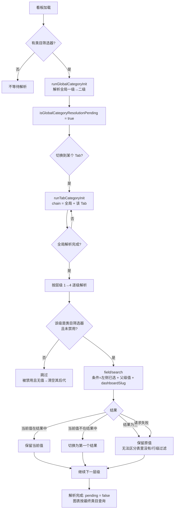
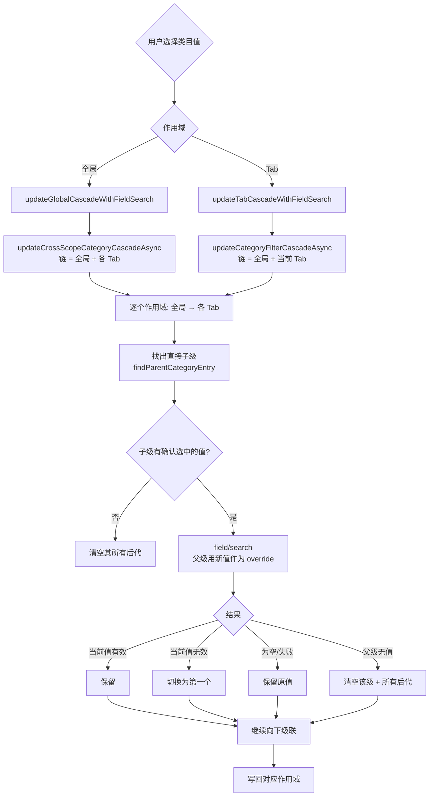

# 看板类目筛选器：跨作用域级联（全局 ⇄ Tab）

> 关联文档：[类目筛选器联动](./category-filter-cascade.md)（单作用域联动的既有语义）
>
> 分支：`feat/tab-filter-category-binding`

## 一、背景与目标

原有类目联动只在**同一个作用域内**生效：

- 全局筛选器之间：全局一级 → 全局二级
- Tab 筛选器之间：Tab 一级 → Tab 二级 → Tab 三级 → Tab 四级

缺失的能力：

1. 全局筛选器无法继续驱动各 Tab 的三级、四级筛选器（全局二级 → Tab 三级 → Tab 四级）
2. 全局与 Tab 出现**同名字段**时无法区分父子关系（只靠 `parentFieldId` 无法定位父级到底在哪个作用域）
3. 父级**中间层缺值**时，下级仍保留旧值 → 查询结果为空（"一级和三级有值、二级没值"）

本特性在保留旧数据兼容的前提下补齐以上能力。

## 二、数据模型

`DashboardFilterRule`（`packages/common/src/types/filter.ts`）新增两个字段，与既有 `parentFieldId` 组合使用：

| 字段            | 类型                | 含义                                                                     |
| --------------- | ------------------- | ------------------------------------------------------------------------ |
| `parentFieldId` | `string`（既有）    | 父级筛选器的**字段 id**（跨作用域绑定时仍指向父级字段）                  |
| `parentScope`   | `'global' \| 'tab'` | 父级所在**作用域**：`global` = 全局筛选器；`tab` = 某个 Tab 的筛选器     |
| `parentTabUuid` | `string`            | 父级所在的 **Tab uuid**（`parentScope === 'tab'` 时有效，缺省=同一 Tab） |

存储位置：

- 全局筛选器 → `dashboard_versions.filters`（JSONB，原样透传）
- Tab 筛选器 → `dashboard_tabs.filters`（JSONB，原样透传）
- Dashboard as-code → `packages/common/src/schemas/json/dashboard-as-code-1.0.json` 已包含新字段

## 三、作用域模型

```
作用域（scope）
├── global：全局筛选器（对所有 Tab 生效）
└── tab：某个 Tab 的筛选器（tabUuid 唯一标识）
```

### 3.1 作用域的「链」（chain）

级联计算统一基于**链**：

```
chain(某个 Tab) = [全局筛选器..., 该 Tab 的筛选器...]
```

- 全局永远排在前面：全局条件对所有 Tab 生效，且是「左侧条件」
- Tab 内保持自身顺序
- 父级查找、`field/search` 的左侧条件、签名计算都基于同一条链

对应实现：`buildCategoryChain({ globalFilters, tabFilters }, tabUuid)`。

### 3.2 父级解析规则（`findParentCategoryEntry`）

1. **显式作用域**（`parentScope` 存在）→ 精确匹配
   - `parentScope === 'global'` → 只在全局筛选器里找
   - `parentScope === 'tab'` → 在 `parentTabUuid` 指定的 Tab 里找（缺省=当前 Tab）
   - 找不到 → **绑定失效**（视为无父级）
2. **旧数据**（只有 `parentFieldId`）→ 兼容规则：**同作用域优先，其次全局**
3. 候选必须满足：不是自身、字段 id 相同、**父级层级严格低于子级**（避免成环）

### 3.3 父级候选（配置界面）

| 当前筛选器作用域 | 可选父级                                                   |
| ---------------- | ---------------------------------------------------------- |
| global           | 仅全局筛选器（全局值对所有 Tab 生效，不能依赖 Tab 筛选器） |
| tab              | 全局筛选器 + 同一 Tab 的筛选器                             |

- 排除自身、排除同字段、排除层级不低于自己的候选
- 候选项展示：`字段名 • 层级 • 作用域`（作用域文案：`全局` / `当前 Tab`）

## 四、配置交互

### 4.1 单个筛选器配置（`FilterConfiguration` / `FilterSettings`）

1. 选择「类目层级」（一级 ~ 四级）
2. 切换层级时**自动选择上一级父级**：同作用域优先 → 其次全局 → 其次第一个候选
3. 也可手动在「父级筛选器」下拉里选择/清除（复合键 `global:<fieldId>` / `tab:<tabUuid>:<fieldId>`，见 `common/parentFilterRef.ts`）
4. 清除父级时 `parentFieldId` / `parentScope` / `parentTabUuid` 三个字段一起清掉

### 4.2 批量绑定（`BatchBindModal`）

- 父级查找规则：同 Tab 优先 → 其次全局
- 应用时写入 `parentFieldId` + `parentScope` + `parentTabUuid`

### 4.3 作用域的传递

- `DashboardFilter` 组件已带 `filterScope: 'global' | 'tab'`
- `FilterConfiguration` 据此决定候选来源，并把 `filterScope` 传给 `FilterSettings`（决定自动选父级时的优先级）
- `BatchBindModal` 额外接收 `globalFilters` 与 `tabUuid`

## 五、运行时流程

### 5.1 首次加载（初始化）



> Tab 初始化必须**等全局解析完成**：全局父级还没定值时解析 Tab，会把 Tab 三级误判为「父级无值」而清空。

### 5.2 用户改值（级联）



### 5.3 断链清空（关键修复）

**场景**：一级有值、二级无值、三级有值 → 三级必须被清空，否则查询带着失效的三级值，结果为空。

判定点在 `resolveCategoryFilterValueAsync`：

- 配了父级、但父级在链上**没有值** → `status: 'clear'` → 清空当前级，并递归清空所有后代
- 父级**绑定失效**（显式作用域找不到对应筛选器）→ 同样按断链处理

与「空候选保留原值」的区别：

| 情况                                      | 处理            | 理由                                       |
| ----------------------------------------- | --------------- | ------------------------------------------ |
| 父级**没有值**（断链）                    | 清空当前级+后代 | 值必然无效，带着查必然空结果               |
| `field/search` 返回**空候选**（父级有值） | 保留原值        | 无法区分「表里没有」与「行级过滤全过滤掉」 |
| `field/search` **请求失败**               | 保留原值        | 无法判断，不改变用户筛选语义               |

## 六、并发、generation 与 pending

- **init 与 cascade 使用独立 generation**：自动初始化不会作废用户刚做的选择
- 手动改动会作废在途的 init（`++initGeneration`）与更早的 cascade
- `skipFilterIds`：联动后的初始化跳过用户刚改的那一级 → 用户的显式选择优先
- **Tab 签名必须覆盖全局祖先**：`getTabCategoryChainSignature` = 全局 + 该 Tab 的链签名；
  全局二级变化 → 签名变化 → Tab 重新解析
- pending 状态：`isGlobalCategoryResolutionPending`（全局）、`pendingTabCategoryResolutions`（各 Tab）
  - 解析完成前图表不发起查询，避免"先出一版未解析的数据再刷新"
  - 等待上限 10s，超时先放行图表，解析完成后再校正一次

## 七、旧数据兼容

| 旧数据                                 | 解析结果                  |
| -------------------------------------- | ------------------------- |
| 只有 `parentFieldId`                   | 同作用域优先，其次全局    |
| `parentScope='global'`                 | 精确匹配全局筛选器        |
| `parentScope='tab'` + `parentTabUuid`  | 精确匹配指定 Tab 的筛选器 |
| `parentScope='tab'` 无 `parentTabUuid` | 视为同一 Tab              |

- `parentScope` / `parentTabUuid` 已进入 Dashboard as-code schema、TSOA 生成的 swagger/routes、筛选器操作日志（`parent_binding` 变更）
- URL/嵌入的 saved filter override 合并时保留 `categoryLevel` / `parentFieldId` / `parentScope` / `parentTabUuid`

## 八、关键代码

| 位置                                                                         | 职责                                               |
| ---------------------------------------------------------------------------- | -------------------------------------------------- |
| `packages/common/src/types/filter.ts`                                        | `parentScope` / `parentTabUuid` 类型定义           |
| `packages/frontend/src/utils/categoryFilters.ts`                             | 链模型、作用域解析、初始化与跨作用域级联、断链清空 |
| `packages/frontend/src/utils/categoryFilterInitHelpers.ts`                   | Tab 初始化决策、跨作用域签名、乐观展示态           |
| `packages/frontend/src/providers/Dashboard/DashboardProvider.tsx`            | 全局/Tab 两条级联流程、generation、pending         |
| `packages/frontend/src/components/DashboardFilter/common/parentFilterRef.ts` | 父级引用的复合键编解码                             |
| `packages/frontend/src/components/DashboardFilter/FilterConfiguration/*`     | 父级候选与配置 UI                                  |
| `packages/frontend/src/components/DashboardFilter/BatchBindModal.tsx`        | 批量绑定的父级选择                                 |
| `packages/frontend/src/hooks/dashboard/dashboardOperationEventQueue.ts`      | 绑定变更（含作用域）的操作日志                     |

主要函数：

- `buildCategoryChain` / `buildCategoryChainFromFilters` / `getCategoryChainFilters`
- `findParentCategoryEntry`（显式作用域精确匹配、旧数据兼容、层级校验）
- `initializeCategoryFiltersAsync`（支持 `scope.chain`）
- `updateCategoryFilterCascadeAsync`（支持 `scope.chain`）
- `updateCrossScopeCategoryCascadeAsync`（全局变更 → 各 Tab 传播）
- `getCategoryFiltersSignature`（含 `parentScope` / `parentTabUuid`）

## 九、验证清单

1. 全局一级 → 全局二级：切换一级，二级跟着变
2. 全局二级 → Tab 三级：Tab 三级绑定全局二级后，切换全局二级，Tab 三级跟着变
3. 全局二级 → Tab 三级 → Tab 四级：逐级联动
4. Tab 内一级 → 二级 → 三级 → 四级：逐级联动
5. 一级有值、二级无值、三级有值：三级被清空（不再带着失效值查询）
6. 全局与 Tab 同名字段：显式绑定后各自独立生效，互不串扰
7. 全局筛选器不能绑定 Tab 筛选器（候选里只有全局）
8. 旧看板（只有 `parentFieldId`）：仍按「同作用域优先，其次全局」联动
9. 用户显式选择不被随后的自动初始化覆盖
10. 临时筛选器（交叉筛选）不参与类目级联、不写回永久配置
11. 跨作用域绑定随看板保存 / 重新加载后仍然生效（as-code 往返保留新字段）
