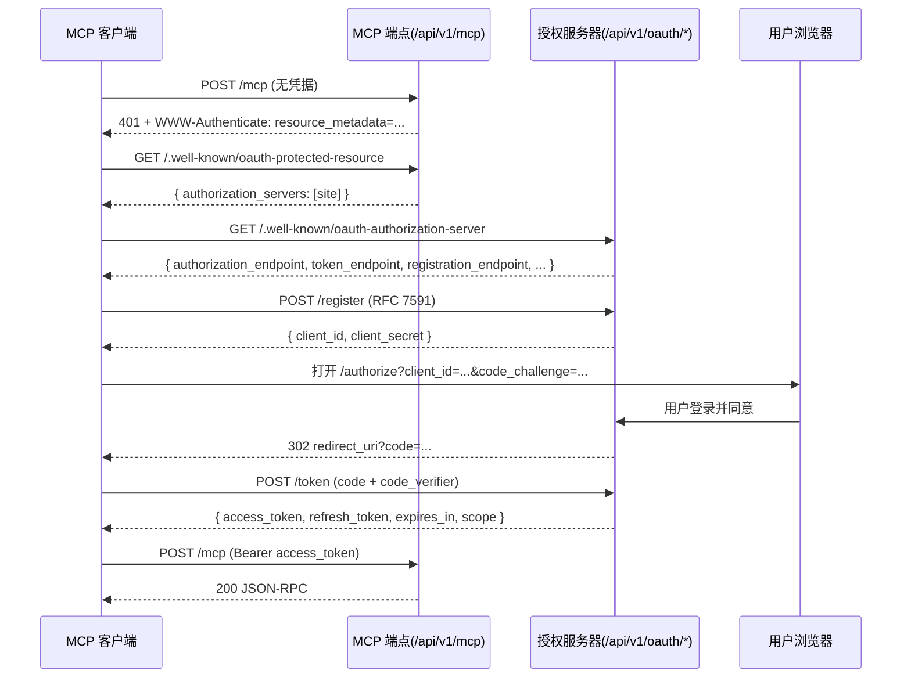

# 自建 MCP 服务与 OAuth 认证：从 Lightdash 内嵌实现抽离的核心要点

> 状态：**已实施并上线**（Lightdash 主站内置 MCP，`v2.6.9`）
> 适用读者：要自建 MCP Server、给现有产品加 MCP 入口、或想搞清 OAuth 授权服务器怎么落地的工程师
> 本文从 `lightdash-i18n` 的实现中提炼，删去业务细节，保留可复用的架构与踩坑结论；第 9 节给出「把 OAuth 从业务服务里抽离成独立组件」的设计取向。

**目录**

- [1. 结论先行](#1-结论先行)
- [2. 为什么 MCP 要自己带一套 OAuth](#2-为什么-mcp-要自己带一套-oauth)
- [3. 端点清单（最小集）](#3-端点清单最小集)
- [4. OAuth 落地的六个关键设计](#4-oauth-落地的六个关键设计)
- [5. 工具注册层的两个坑](#5-工具注册层的两个坑)
- [6. 客户端实际请求序列](#6-客户端实际请求序列)
- [7. 三个真实事故与根因](#7-三个真实事故与根因)
- [8. 如果要自己写 OAuth 客户端](#8-如果要自己写-oauth-客户端)
- [9. 把 OAuth 从业务服务抽离的取向](#9-把-oauth-从业务服务抽离的取向)
- [10. 最小可运行骨架](#10-最小可运行骨架)
- [11. 上线 Checklist](#11-上线-checklist)
- [12. 相关文档](#12-相关文档)

---

## 1. 结论先行

一个能对接主流 MCP 客户端（Claude Code、Cursor、WorkBuddy、Apifox 等）的自建 MCP 服务，最小可用形态是：

| 能力 | 做法 | 不做什么 |
|---|---|---|
| 协议传输 | 主站 HTTP 服务内挂一个 **Streamable HTTP** 端点（`POST /api/v1/mcp`） | 不单开进程、不单开端口 |
| 会话 | **无状态**（`sessionIdGenerator: undefined`），每请求独立 | 不维护 MCP session id、不做 sticky session |
| 鉴权 | 双通道：**PAT**（简单）+ **OAuth 2.1**（标准） | 不做自研 token 格式 |
| 授权服务器 | 用现成库实现（`@node-oauth/oauth2-server`），自己只写 model | 不手写签名/校验/轮转逻辑 |
| 状态存储 | Token 全部 **opaque 存数据库** | 不用 JWT（无法即时吊销）、不放内存（重启丢） |
| 元数据 | 暴露 RFC 8414 / RFC 9728 `.well-known` | 不让客户端猜端点 |

代价：需要实现 OAuth 的一堆端点（authorize / token / introspect / revoke / register）和两个元数据文档；好处是**客户端零配置**——用户只填一个 URL，客户端自动发现授权服务器、自动注册、自动走授权码流程。

---

## 2. 为什么 MCP 要自己带一套 OAuth

MCP 客户端（尤其托管的 SaaS 类）接入第三方服务时，普遍遵循同一个约定：

1. 未认证地打一次 MCP 端点
2. 服务端返回 `401` + `WWW-Authenticate: Bearer resource_metadata="<URL>"`（RFC 9728）
3. 客户端去 `<URL>` 拿「受保护资源元数据」，从中得知 `authorization_servers`
4. 再去授权服务器的 `/.well-known/oauth-authorization-server`（RFC 8414）拿端点清单
5. 没有预注册 client 时，调 `registration_endpoint` 做**动态客户端注册**（RFC 7591）
6. 起浏览器走**授权码流程**，带 PKCE，回调拿到 authorization code，换 access token
7. 带着 access token 回到 MCP 端点



**要点**：把 `.well-known` 挂在**站点根目录**而不只是在 `/api/v1/oauth/` 下。很多客户端硬编码根路径 `/.well-known/oauth-authorization-server`，挂在子路径会直接发现失败。

---

## 3. 端点清单（最小集）

| 端点 | 规范 | 作用 |
|---|---|---|
| `POST /api/v1/mcp` | MCP Streamable HTTP | JSON-RPC：`initialize` / `tools/list` / `tools/call` / `prompts/*` |
| `GET /.well-known/oauth-protected-resource` | RFC 9728 | 资源元数据，指向授权服务器 |
| `GET /.well-known/oauth-authorization-server` | RFC 8414 | 授权服务器元数据 |
| `GET /authorize` | OAuth 2.1 | 渲染同意页（未登录先跳登录） |
| `POST /authorize` | OAuth 2.1 | 用户同意后签发 authorization code |
| `POST /token` | OAuth 2.1 | code / refresh_token / client_credentials 换 token |
| `POST /introspect` | RFC 7662 | token 自省（可选但客户端常用） |
| `POST /revoke` | RFC 7009 | 吊销（可选，见 §7 坑） |
| `POST /register` | RFC 7591 | 动态客户端注册 |

元数据里两个字段尤其重要：

```jsonc
{
  "scopes_supported": ["mcp:read", "mcp:write"],   // ← 客户端会照这个请求（见 §7 事故 1）
  "code_challenge_methods_supported": ["S256", "plain"],
  "token_endpoint_auth_methods_supported": ["client_secret_basic", "client_secret_post"],
  "grant_types_supported": ["authorization_code", "refresh_token", "client_credentials"]
}
```

---

## 4. OAuth 落地的六个关键设计

### 4.1 用现成库，只写 model

`@node-oauth/oauth2-server`（Node 生态最成熟）的用法是：**你实现 model 接口，库负责协议状态机**。

```ts
export class OAuth2Model implements AuthorizationCodeModel {
    constructor(private database: Knex) {}

    // 客户端查询（含已注册 scopes —— 见 4.3）
    async getClient(clientId: string, clientSecret?: string | null) { /* ... */ }

    // 授权码
    async saveAuthorizationCode(code, client, user) { /* INSERT */ }
    async getAuthorizationCode(code: string) { /* SELECT */ }
    async revokeAuthorizationCode(code) { /* DELETE */ }

    // token
    async saveToken(token, client, user) { /* INSERT access + refresh */ }
    async getAccessToken(accessToken: string) { /* SELECT join users */ }
    async getRefreshToken(refreshToken: string) { /* SELECT */ }
    async revokeToken(token) { /* DELETE refresh */ }

    // scope 约束（4.3）
    async validateScope(user, client, scope) { /* ... */ }
}
```

库负责：错误码、PKCE 校验、`state` 校验、token 过期判断、grant type 分发。
你自己负责：数据库读写、scope 策略、用户权限。

### 4.2 Token 全部 opaque + 存库

**不要用 JWT。** 原因：

- JWT 无法即时吊销（除非维护黑名单，那还不如直接查库）
- JWT 需要签名密钥管理（轮换、多副本同步、泄露恢复）
- MCP token 生命周期短（1h）+ refresh 续期，查库开销可接受

三张表（`TEXT[]` 存 scope）：

```sql
oauth2_clients(client_id PK, client_secret, redirect_uris TEXT[], grants TEXT[], scopes TEXT[], ...)
oauth2_access_tokens(access_token PK, expires_at, scope TEXT[], client_id FK, user_id FK, organization_uuid FK)
oauth2_refresh_tokens(refresh_token PK, expires_at, scope TEXT[], client_id FK, user_id FK, organization_uuid FK)
oauth2_authorization_codes(authorization_code PK, expires_at, redirect_uri, scope TEXT[], code_challenge, ...)
```

**关键收益：服务重启零影响。** 认证路径每次查库比对 `expires_at`，没有进程内状态，多副本天然一致。这一点在 K8s 滚动更新下极其重要——否则每次发版用户都要重新登录。

有效期（可环境变量覆盖）：

| Token | 默认 | 说明 |
|---|---|---|
| access_token | 1h | 短，降低泄露面 |
| refresh_token | 2 周 | 静默续期窗口 |
| authorization code | 5min | 一次性 |

### 4.3 scope 约束：必须实现 `validateScope`，但**别整单拒绝**

这是最容易出事的地方，也是本文 §7 事故 1 的根因。

不实现 `validateScope` 时，`@node-oauth/oauth2-server` 的行为是**原样返回请求的 scope**——客户端申请 `mcp:write` 就给 `mcp:write`，哪怕这个 client 注册时只有 `mcp:read`。「只读客户端」这个承诺形同虚设。

正确实现（交集发放，不整单拒）：

```ts
async validateScope(_user, client, scope?: string[]): Promise<string[] | false> {
    const allowed = Array.isArray(client.scopes) ? client.scopes : [client.scopes].filter(Boolean);
    if (allowed.length === 0) return false;

    const requested = (scope ?? []).filter((s) => s.length > 0);
    if (requested.length === 0) {
        // 空 scope → 默认发 client 注册的 MCP scope
        const mcp = allowed.filter((s) => s.startsWith('mcp:'));
        return mcp.length > 0 ? mcp : allowed;
    }

    const allowedSet = new Set(allowed);
    const granted = requested.filter((s) => allowedSet.has(s));
    if (granted.length === 0) return false;        // 全都未注册 → 拒
    return granted;                                 // 部分未注册 → 只发交集
}
```

同时 `getClient()` **必须把 `scopes` 一起返回**，否则 `validateScope` 拿不到已注册 scope：

```ts
return { clientId, id: clientId, redirectUris, grants, scopes };
```

### 4.4 双通道鉴权：PAT + OAuth 并存

OAuth 全流程对「只想写个脚本」的人太重。保留一条 PAT 通道收益很大：

```ts
mcpRouter.all(
    '/',
    allowOauthAuthentication,      // 先试 Bearer
    allowApiKeyAuthentication,     // 再试 ApiKey
    returnHeaderIfUnauthenticated, // 都不行 → 401 + WWW-Authenticate
    handler,
);
```

- **OAuth 通道**受 scope 约束（`mcp:read` 才能用 MCP）
- **PAT 通道**按设计不受 scope 约束（用户自己给自己发的 token，权限即用户权限）
- 两条通道最终都要构造同一个「鉴权上下文」对象（`authType: 'oauth' | 'pat'`、`scopes`、`user`、`ability`），下游工具代码不关心来源

`returnHeaderIfUnauthenticated` 是客户端能自动发现 OAuth 的**唯一入口**，务必带 RFC 9728 要求的头：

```ts
res.set('WWW-Authenticate',
  `Bearer resource_metadata="${baseUrl}/.well-known/oauth-protected-resource"`);
res.status(401).json({ error: 'Unauthorized' });
```

### 4.5 状态机顺序：先鉴权，再挂 transport

无状态 Streamable HTTP 的写法通常是「每请求 new transport → `server.connect(transport)` → `transport.handleRequest()`」。**务必把权限校验放在 `connect()` 之前**：

```ts
// ✅ 正确
const authInfo = buildMcpAuthInfo(req.user, req.account);
assertCanAccessMcp(authInfo.extra);        // 可能 throw → catch 返回 403
await server.connect(transport);
await transport.handleRequest(req, res, req.body);

// ❌ 错误：被拒的请求已经把 transport 挂到共享 server 上了
await server.connect(transport);
assertCanAccessMcp(...);                   // throw 后 transport 残留在 server 上
```

原因：SDK 的 `connect()` 会**无条件覆盖** server 的 `_transport` 字段。被拒绝的请求也会挤掉上一个正常请求的 transport。

### 4.6 `GET` SSE 分支要单独鉴权

`router.all()` 里 `GET` 和 `POST` 分支是分开 return 的，极易漏掉鉴权。MCP 的 `GET /mcp` 是 SSE 长连接通道：

```ts
// ✅ 把鉴权提到方法分支之前，GET/POST 共享
const authInfo = buildMcpAuthInfo(req.user, req.account);
assertCanAccessMcp(authInfo.extra);
if (req.method === 'GET') { /* SSE */ }
if (req.method === 'POST') { /* JSON-RPC */ }
```

否则「任意已登录会话」都能无限量开 SSE 长连接（每个连接还有一个定时心跳），是廉价资源耗尽面。

---

## 5. 工具注册层的两个坑

### 5.1 `server.prompt()` 的三参重载

MCP SDK 1.x 里：

```ts
server.prompt(name, argsSchema, cb)        // argsSchema 是 ZodRawShape
server.registerPrompt(name, config, cb)    // config = { description?, argsSchema? }
```

想把 `{description, argsSchema}` 当整体传，必须用 **`registerPrompt`**。用 `prompt(name, config, cb)` 会把整个 config 对象当 zod shape 包进 `z.object()`，随后 `prompts/list` 对字符串字段调 `.isOptional()` 直接报错：

```
MCP error -32603: field.isOptional is not a function
```

工具端（`registerTool`）没有这个歧义，只有 prompt 有。

### 5.2 scope 校验闸门要放在注册层，不要散在工具里

所有工具经过同一个注册工厂，闸门只写一次：

```ts
registerTool(name, config, handler) {
    // 统一注入鉴权 + scope 校验
    const wrapped = async (args, sdkContext) => {
        const ctx = buildToolContext(sdkContext);
        assertToolAccess(ctx, name);        // 按工具所需 scope 校验
        trackStart(name, ctx);
        try { return await handler(args, ctx); }
        finally { trackEnd(name, ctx); }    // 埋点统一收口
    };
    ...
}
```

注意 `MCP_TOOL_SCOPES[toolName] ?? Read` 这种**默认放行**是 fail-open：新增工具忘记登记 scope 会自动变成「只读即可」。建议改成 fail-closed。

---

## 6. 客户端实际请求序列

接入 Apifox / 标准客户端后的真实请求序列：

```jsonc
// 1. initialize —— 双方协商协议版本
{"jsonrpc":"2.0","id":0,"method":"initialize","params":{
  "protocolVersion":"2025-11-25","capabilities":{},
  "clientInfo":{"name":"Apifox MCP Client","version":"2.8.22"}}}

// 2. 服务端返回自己支持的版本（可以比客户端旧）
{"jsonrpc":"2.0","id":0,"result":{
  "protocolVersion":"2025-06-18",
  "capabilities":{"tools":{"listChanged":true},"prompts":{"listChanged":true}},
  "serverInfo":{"name":"...","version":"..."}}}

// 3. notification（无 id，不需要响应）
{"jsonrpc":"2.0","method":"notifications/initialized"}

// 4. 并发拉工具和 prompts
{"jsonrpc":"2.0","id":1,"method":"tools/list"}
{"jsonrpc":"2.0","id":2,"method":"prompts/list"}
```

**要点**：
- `POST` 必须接受 `Accept: application/json, text/event-stream`（只给 `application/json` 有些客户端会 406）
- 无状态模式下**不需要**返回 `Mcp-Session-Id`
- 客户端会自动探测 `prompts/list`。如果只实现工具不实现 prompt，`prompts/list` 返回 `-32601 Method not found` 是可以接受的（客户端会跳过）

---

## 7. 三个真实事故与根因

### 事故 1：收紧 scope 后所有客户端拿不到 token（最典型）

**改动**：给 `validateScope` 加严格校验（请求 scope 必须全部 ⊆ 已注册 scope）。

**现象**：上线后 MCP 客户端全线连不上，日志 `401 invalid_token` / `unauthorized_request`。

**根因**：元数据通告 `scopes_supported: ["mcp:read", "mcp:write"]`，标准客户端会**请求全部通告的 scope**（`mcp:read mcp:write`）；而该 client 注册时只落了 `mcp:read`。全有或全无的校验 → 整单 400 `invalid_scope` → token 签发链路直接断裂。

**为什么预发没测出来**：预发验证走的是 PAT 通道，而 PAT 按设计绕过 scope 校验；`validateScope` 只在 OAuth 授权流程生效。**测试通道和问题通道不是同一条。**

**修复**：改为发放交集（§4.3）。

**教训（两条，都很贵）**：
1. 收紧授权逻辑时，必须对照**己方元数据通告**（`scopes_supported`）核对标准客户端行为——它会请求你通告的一切
2. 鉴权改动必须用**出问题的那条通道**验证（OAuth 就要用 OAuth 测，不能拿 PAT 测完就算）

**修复上线 ≠ 用户恢复。** 这是本次最反直觉的一点：坏窗口期签发的 token **不会自愈**。

- `@node-oauth/oauth2-server` 的 refresh 流程**不调用 `validateScope`**（`refresh-token-grant-type.js` 的 `saveToken` 直接沿用旧 scope）。scope 错了就一路错下去，1 小时 access token 过期后靠 refresh 续命，坏 scope 被永久继承。
- 结果：服务端修好了，客户端还是 401/403，直到**重新走一次完整授权**（删掉连接重建）。

因此这类事故的处置清单里必须有一条：**列出受影响用户，通知他们重建连接**，而不是修完代码就宣布恢复。

### 事故 2：迁移里 `text[] || 'literal'` 必挂

```sql
-- ❌ 报 malformed array literal: "mcp:read" / Array value must start with "{"
UPDATE oauth2_clients SET scopes = scopes || 'mcp:read' WHERE ...;

-- ✅
UPDATE oauth2_clients SET scopes = array_append(scopes, 'mcp:read') WHERE ...;
```

**根因**：PG 里字符串字面量是 unknown 类型，`||` 按「与另一参数同类型」规则被解析成**数组拼接**（`anyarray || anyarray`），于是把 `'mcp:read'` 当数组字面量解析。`SELECT ARRAY['a'] || 'c'` 同样报错。

注意：`array_col || 42` 能跑（数字类型已知），**只有裸字符串字面量踩坑**。原生 SQL 迁移合并前必须在真库跑一遍 `migrate:latest`。

### 事故 3：`GET /mcp` 的 SSE 分支漏掉鉴权与 scope 闸门

MCP 的 Streamable HTTP 里，`POST` 是业务请求，`GET` 是**服务端 → 客户端的 SSE 通道**。两者在同一个 `router.all()` 里，但代码上是**两个提前 return 的分支**——鉴权只写在了 `POST` 分支里：

```ts
// ❌ 出事版本：GET 在 scope 校验之前就 return 了
if (req.method === 'GET') {
    res.writeHead(200, {
        'Content-Type': 'text/event-stream',
        'Access-Control-Allow-Origin': '*',   // ← 通配 CORS
        ...
    });
    const heartbeat = setInterval(() => res.write('event: heartbeat\n\n'), 30000);
    return;                                    // ← 走了，下面才校验
}
if (req.method === 'POST') {
    const authInfo = buildMcpAuthInfo(req.user, req.account);
    mcpService.canAccessMcp(authInfo.extra);   // ← 只有 POST 校验
    ...
}
```

叠加出三个问题：

1. **鉴权口径不一致**：`POST` 缺 scope 给 403，`GET` 却直接 200。任何「已登录会话」或「持有 token 但缺 `mcp:read` 的客户端」都能开 SSE。
2. **无限流、无并发上限**：每个连接还带一个 30s 心跳 `setInterval`，且不随进程关闭清理 → 廉价的资源耗尽面。
3. **通配 CORS**：`Access-Control-Allow-Origin: *` 让任意站点能发起带凭据的长连接。MCP 客户端基本是服务端到服务端，这条根本不需要。

**修复**：把鉴权提到方法分支**之前**，让 `GET`/`POST` 共享同一道闸门，并去掉通配 CORS：

```ts
// ✅ 鉴权前置，两个分支共享
const authInfo = buildMcpAuthInfo(req.user, req.account);
mcpService.canAccessMcp(authInfo.extra);

if (req.method === 'GET') { /* SSE */ }
if (req.method === 'POST') { /* JSON-RPC */ }
```

**教训**：`router.all()` + 分支内提前 return 是鉴权漏洞的经典温床。凡是有多个 HTTP 方法共享一个 handler，鉴权必须写在**方法判断之前**；同时要意识到 MCP 的 `GET` 不是「读接口」，而是一条长期占用的通道。

---

## 8. 如果要自己写 OAuth 客户端

自己构建 MCP 客户端时，最小实现 Checklist：

**发现阶段**
1. `POST` MCP 端点，捕获 `401` + `WWW-Authenticate` 头，解析 `resource_metadata` URL
2. `GET resource_metadata` → 取 `authorization_servers[0]`
3. `GET <as>/.well-known/oauth-authorization-server` → 取各 endpoint + `scopes_supported`

**注册阶段**（可选，若服务端已预置 client 可跳过）
4. `POST registration_endpoint`，body `{client_name, redirect_uris: ["http://localhost:PORT/callback"], scope: "mcp:read"}`

**授权阶段**
5. 生成 `code_verifier`（43-128 字符随机）+ `code_challenge = BASE64URL(SHA256(verifier))`
6. 起本地回调服务，打开浏览器到 `authorization_endpoint?response_type=code&client_id=...&redirect_uri=...&scope=...&state=...&code_challenge=...&code_challenge_method=S256`
7. 回调收 `code`（校验 `state`！）
8. `POST token_endpoint`，`grant_type=authorization_code&code=...&code_verifier=...&redirect_uri=...`（+ client 认证）

**使用阶段**
9. `Authorization: Bearer <access_token>` 打 MCP 端点
10. 收到 401 且 token 已过期 → `grant_type=refresh_token` 换新
11. 本地安全存储 refresh_token（**不要**写进项目里的配置文件）

**技术栈建议**

| 部分 | 选择 | 说明 |
|---|---|---|
| 客户端传输 | 官方 `@modelcontextprotocol/sdk`（client 部分） | 别手写 JSON-RPC |
| OAuth | 直接 HTTP 调端点即可 | PKCE 只需 `crypto.subtle.digest('SHA-256')`，不值得引库 |
| 本地回调 | `node:http` 起临时端口 | 端口要写进 `redirect_uris`；或用 `http://127.0.0.1` 任意端口（部分服务端支持通配） |
| Token 存储 | OS keychain / `~/.config/<app>/` + `chmod 600` | 切忌放项目目录 |
| CLI 框架 | 任意（commander / clipanion） | — |

**协议版本**：客户端 `initialize` 报自己支持的 `protocolVersion`，服务端回它自己支持的版本，双方按服务端返回的版本继续。当前主流是 `2025-03-26` / `2025-06-18` / `2025-11-25`，SDK 1.17.x 支持到 2025-11-25。

---

## 9. 把 OAuth 从业务服务抽离的取向

当前实现是**嵌在业务后端里**的（复用 DB、User model、session）。如果要做成可复用组件，切分线建议这样：

### 9.1 应该抽出去的（无业务语义）

- **授权服务器端点**：`/authorize` `/token` `/introspect` `/revoke` `/register` + 两个 `.well-known`
- **Token store**：4 张表 + `OAuth2Model`（只需一个 `User` 接口 + 一个 `Client` 表）
- **PKCE / state / 过期 / 轮转** 全部委托给 `@node-oauth/oauth2-server`
- **scope 策略**（§4.3 的交集发放）——纯逻辑，无业务

抽象成组件后，接入方只需提供三个回调：

```ts
interface OAuthIntegration {
    // 用户从哪来（session / 外部 IdP / CAS）
    resolveUser(req): Promise<{ id: string; org: string; ability: unknown } | null>;
    // 渲染同意页（各产品 UI 不同）
    renderConsent(params): string;
    // scope → 业务权限的映射
    assertScopeAllowed(user, scope): Promise<boolean>;
}
```

### 9.2 应该留在业务侧的

- **MCP 工具实现**（每个工具都是业务查询）
- **权限模型**（CASL `ability`、项目级可见性）
- **`buildMcpAuthInfo`**：把「OAuth token / PAT」统一成业务鉴权上下文
- **埋点**（`mcp_tool_call`：toolName / user / org / project / authType / durationMs / success）

### 9.3 抽离的实际收益（Lightdash 场景已验证）

审计时发现的三处硬编码业务耦合，全部是「抽离后会自然消失」的：

- 抓用户要 join `users` 表 → 抽离后由 `resolveUser` 回调供给
- `organization_uuid` 直接作为 token 表外键 → 抽离后作为 `context` JSON 字段
- 同意页用 Handlebars 模板绑死产品 UI → 抽离后是 `renderConsent` 回调

---

## 10. 最小可运行骨架

前面各节拆开讲了原理，这里给一份**文件职责清单**，可以直接照着搭。关键点是：**鉴权与 scope 闸门只出现在两个地方**（`mcp/router` 的入口 + `registry` 的注册层），工具实现里不要再散落权限判断。

```
src/
├── oauth/
│   ├── model.ts        # OAuth2Model：getClient / saveToken / getAccessToken
│   │                   #   / getRefreshToken / validateScope  ← 交集发放
│   └── router.ts       # GET /authorize     （渲染同意页，未登录先跳登录）
│                       # POST /authorize    （签发 code）
│                       # POST /token        （code / refresh / client_credentials）
│                       # POST /introspect   （RFC 7662）
│                       # POST /revoke       （RFC 7009）
│                       # POST /register     （RFC 7591 动态注册）
│                       # GET  /.well-known/*（RFC 8414 + 9728）
├── mcp/
│   ├── router.ts       # POST /mcp（JSON-RPC）+ GET /mcp（SSE）
│   │                   #   ← 鉴权链 + canAccessMcp（方法分支之前）
│   ├── authInfo.ts     # buildMcpAuthInfo：把 OAuth token / PAT / session
│   │                   #   统一成 { user, account, authType, scopes }
│   └── tools/
│       ├── registry.ts # registerTool / registerPrompt 包装器
│       │               #   ← assertToolAccess（工具级 scope 闸门，单点）
│       ├── deps.ts     # 依赖注入（service 集合），便于测试
│       └── *.ts        # 各工具实现：只做业务，不碰鉴权
└── db/migrations/
    └── *_oauth_tables.ts  # oauth2_clients / access_tokens / refresh_tokens
                           #   / authorization_codes
```

三层职责边界：

| 层 | 只管 | 绝不碰 |
|---|---|---|
| `mcp/router` | HTTP 方法分发、MCP 通道、**入口鉴权** | 业务查询 |
| `mcp/tools/registry` | 工具注册、参数透传、**scope 闸门**、埋点 | HTTP 语义 |
| `mcp/tools/*.ts` | 业务实现 | 鉴权、scope、埋点 |

## 11. 上线 Checklist

- [ ] `POST /mcp` 未认证返回 401 + `WWW-Authenticate`（**不是** 403，否则客户端不会启动发现流程）
- [ ] `.well-known` 挂在**站点根**（不只是 API 子路径）
- [ ] `validateScope` 已实现，且行为是**交集发放**（不是整单拒绝）
- [ ] `getClient()` 返回 `scopes`
- [ ] 权限校验在 `server.connect()` **之前**
- [ ] `GET`（SSE）分支与 `POST` 走同一鉴权
- [ ] Token 全存库（重启不失效），验证方式：发 token → 重启服务 → 用同一 token 请求成功
- [ ] 用 **OAuth 通道** 做过端到端测试（不是只测 PAT）
- [ ] 权限拒绝路径有测试（OAuth token 缺 scope 应 403，不应 200）
- [ ] 过期 token 有清理任务，或明确接受表增长

---

## 12. 相关文档

- [统一后端 MCP 模式与上线排障](../mcp/mcp-unified-backend-status.md)：Lightdash 侧的实施归档与事故记录
- [v2 接入指南](../mcp/mcp-v2-guide.md)：客户端接入、工具清单、配置项
- [Session 生命周期与并发设计](../mcp/lightdash-mcp-session-lifecycle.md)：有状态实现对照（本文为无状态方案）
