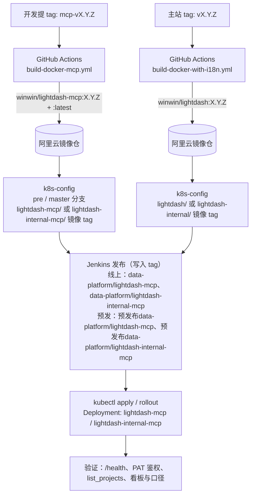
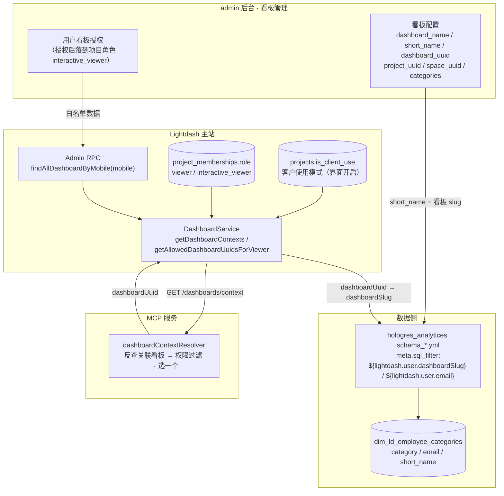
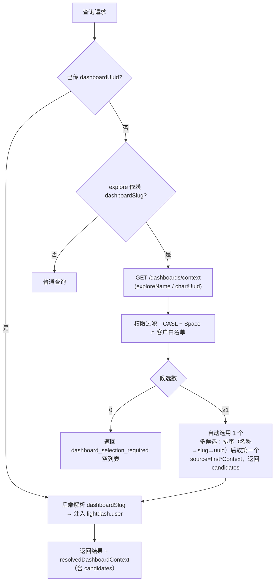

# MCP 服务上线流程文档

| 项 | 内容 |
|---|---|
| 状态 | **草稿 v0.3**（待确认项见 [§11](#11-待确认事项tbd)） |
| 主题 | MCP 服务（`packages/lightdash-mcp`）从打 tag → 镜像 → 集群发布的**端到端上线流程**，含配置清单、关联关系、权限模型、验收与回滚 |
| 涉及系统 | **admin 后台**（看板管理与授权数据源）、**Lightdash**（主站 + MCP 服务）、**GitHub Actions**（构建镜像）、**Jenkins**（发布到集群）、k8s-config（部署清单）、Apisix（网关） |
| 部署目标 | **2 个预发 + 2 个线上**：预发·内部、预发·外部品牌CT、线上·内部、线上·外部品牌CT（见 [§3.3](#33-四套部署目标)） |
| 适用范围 | 当前 `dev` 分支的 MCP 服务（`@lightdash/mcp`）。**v2 在独立分支、尚未上线**，不在本文范围 |

---

## 1. 一页速览

```
① 打 tag（mcp-v*）→ ② GitHub Actions 构建并推送镜像 → ③ Jenkins 发布（写入 tag / apply 清单）
→ ④ 滚动更新 Pod → ⑤ 验证 /health、PAT 鉴权、权限与口径
```

**发布顺序：先主站（Lightdash），后 MCP 服务。**
主站若本次有权限/接口改动，先发主站，再发 MCP。

---

## 2. 系统与职责

| 系统 | 在 MCP 上线中的职责 | 位置 |
|---|---|---|
| **Lightdash 主站** | 提供 REST API、看板权限判定、行级 `sql_filter` 执行；发放 PAT | `packages/backend`、`packages/common` |
| **Lightdash MCP 服务** | 独立进程，把主站 REST 能力以 MCP 协议暴露给 Cursor / Claude Code 等客户端 | `packages/lightdash-mcp`、`Dockerfile` |
| **GitHub Actions** | 打 tag 触发构建镜像并推送到阿里云镜像仓 | `.github/workflows/build-docker-mcp.yml` |
| **Jenkins** | 发布：更新镜像 tag / 应用 k8s-config 清单，滚动更新集群 | [jenkins.banmahui.cn](https://jenkins.banmahui.cn/)，入口见 [§3.2](#32-jenkins-发布关键) |
| **k8s-config** | 部署清单：Deployment / Service / ConfigMap / ApisixRoute | `msy/ops/k8s-config`（分支 `pre` / `master`） |
| **admin 后台** | **看板管理**（[admin.banmahui.cn/report/x-platform/manage](https://admin.banmahui.cn/report/x-platform/manage)）：看板登记、`short_name` 维护、用户看板授权。**入口唯一**（服务品牌CT Lightdash）；内部平台开启客户使用模式后同样受此约束 | `winwin-report`（JSON-RPC）+ brand-fe 管理后台 |
| **dbt（hologres_analytices）** | 看板口径与行级权限的**唯一来源**（`meta.sql_filter`） | `models/marts/*/schema_*.yml` |
| **Apisix** | 对外域名、证书、限流 | k8s-config `apisix/` |

**鉴权现状：** MCP 客户端用自己的 **PAT**（个人访问令牌）通过请求头 `x-api-key` 传给 MCP 服务，MCP 再用它调主站 REST。主站侧发放 PAT。

---

## 3. 发布流程



### 3.1 tag 与镜像规则

| 组件 | tag 规则 | 触发 workflow | 镜像 |
|---|---|---|---|
| MCP 服务 | `mcp-vX.Y.Z` | `.github/workflows/build-docker-mcp.yml` | `registry.cn-hangzhou.aliyuncs.com/winwin/lightdash-mcp` → 推 `:X.Y.Z` 与 `:latest` |
| Lightdash 主站 | `vX.Y.Z`（排除 `mcp-v*` / `cli-v*`） | `.github/workflows/build-docker-with-i18n.yml` | `registry.cn-hangzhou.aliyuncs.com/winwin/lightdash` |

- 非 tag 构建会推 `sha-<12位>` 镜像，仅供调试，**不能上线**。
- 集群清单用的是 **VPC 镜像仓** `registry-vpc.cn-hangzhou.aliyuncs.com/...`，需确认 tag 已同步/可见。
- MCP 包版本由 `pnpm bump-mcp -- X.Y.Z`（`scripts/bump-versions.mjs`）写入 `packages/lightdash-mcp/package.json`，tag 需与之对应。

### 3.2 Jenkins 发布（关键）

**入口：** [https://jenkins.banmahui.cn/](https://jenkins.banmahui.cn/)

| 环境 | 线 | job 链接 | 对应 k8s-config |
|---|---|---|---|
| 线上 | 外部品牌CT | https://jenkins.banmahui.cn/job/data-platform/job/lightdash-mcp/ | `master` 分支 `lightdash-mcp/` |
| 线上 | 内部 | https://jenkins.banmahui.cn/job/data-platform/job/lightdash-internal-mcp/ | `master` 分支 `lightdash-internal-mcp/` |
| 预发 | 外部品牌CT | https://jenkins.banmahui.cn/job/%E9%A2%84%E5%8F%91%E5%B8%83data-platform/job/lightdash-mcp/ | `pre` 分支 `lightdash-mcp/` |
| 预发 | 内部 | https://jenkins.banmahui.cn/job/%E9%A2%84%E5%8F%91%E5%B8%83data-platform/job/lightdash-internal-mcp/ | `pre` 分支 `lightdash-internal-mcp/` |

（预发布目录 URL 编码形式：`%E9%A2%84%E5%8F%91%E5%B8%83data-platform`）

**步骤：**

1. 确认 GitHub Actions 已把 `mcp-vX.Y.Z` 镜像推上（`winwin/lightdash-mcp:X.Y.Z`）。
2. 打开对应环境、对应线的 job，**写入 tag**（镜像版本号）→ 构建。
3. job 拉取 k8s-config 对应分支并 apply / 更新 Deployment 镜像后滚动更新。
4. 观察 Pod 滚动更新与 `/health`。
5. 失败时用上一版 tag 再发一次即可回滚（见 [§9](#9-回滚)）。

> 📷 **待补图 A**：Jenkins job 页面（填 tag / 构建按钮位置）
> ``

本地等价操作（不经过 Jenkins）：

```bash
cd k8s-config && git checkout pre        # 或 master
# 编辑 lightdash-mcp/lightdash-mcp.yml（或 lightdash-internal-mcp/lightdash-internal-mcp.yml）的 image tag
./utils/k8s-apply lightdash-mcp          # 内部按分支自动选 namespace：prod / tars-pre
kubectl -n pre rollout status deploy/lightdash-mcp
```

### 3.3 四套部署目标

| | 线上·外部品牌CT | 预发·外部品牌CT | 线上·内部 | 预发·内部 |
|---|---|---|---|---|
| 客户端 URL | `https://mcp-x.brandct.com/mcp` | `https://mcp-x.pre.banmahui.cn/mcp` | `https://mcp-lightdash.banmahui.cn/mcp` | `https://mcp-lightdash.pre.banmahui.cn/mcp` |
| Apisix hosts | `mcp-x.brandct.com`、`mcp.x.brandct.com` | `mcp-x.pre.banmahui.cn`、`mcp.x.pre.banmahui.cn` | `mcp-lightdash.banmahui.cn`、`mcp.lightdash.banmahui.cn` | `mcp-lightdash.pre.banmahui.cn`（`mcp.lightdash.pre…`） |
| K8s 目录 | `lightdash-mcp/` | `lightdash-mcp/` | `lightdash-internal-mcp/` | `lightdash-internal-mcp/` |
| Deployment | `lightdash-mcp` | `lightdash-mcp` | `lightdash-internal-mcp` | `lightdash-internal-mcp` |
| namespace | `prod` | `tars-pre` | `prod` | `tars-pre` |
| 集群内主站 | `http://lightdash.default:8080` | `http://lightdash:8080` | `http://lightdash-internal.default:8080` | `http://lightdash-internal:8080` |
| 主站清单 | `lightdash/` | `lightdash/` | `lightdash-internal/` | `lightdash-internal/` |
| 公网主站根 | `https://x.brandct.com` | 预发主站 | `https://lightdash.banmahui.cn` | 预发主站 |
| 默认项目 | `LIGHTDASH_PROJECT_UUID`（品牌账号项目） | 同左 | `LIGHTDASH_PROJECT_UUID`（POS DB 项目） | 同左 |

> 域名一律**优先用连字符形式**（`mcp-x…` / `mcp-lightdash…`），点分旧名（`mcp.x…`）可能与通配证书不匹配。

---

## 4. 配置清单

### 4.1 MCP 服务（k8s-config：ConfigMap + Secret）

| 变量 | 放哪 | 必填 | 说明 |
|---|---|---|---|
| `PORT` / `LIGHTDASH_MCP_HTTP_PORT` | ConfigMap | 否 | 监听端口，默认 `3333` |
| `LIGHTDASH_SITE_URL` | ConfigMap | 是 | 集群内主站根（MCP 调 REST） |
| `LIGHTDASH_PUBLIC_SITE_URL` | ConfigMap | 否 | 浏览器打开用的公网根（拼 webUrl 用），未设则回退 `LIGHTDASH_SITE_URL` |
| `LIGHTDASH_PROJECT_UUID` | ConfigMap | 建议 | MCP 默认项目；客户端也可显式传 `projectUuid` |
| `LIGHTDASH_API_KEY` | Secret / ConfigMap | 否 | 服务端兜底 PAT。**线上不配置**：客户使用 MCP 时必须自行填写 PAT（`x-api-key`），MCP 侧不做兜底 |
| `LIGHTDASH_MAX_LIMIT` | ConfigMap | 否 | 查询类接口的 `limit` 上限 |
| `LIGHTDASH_MCP_MAX_SESSIONS` / `LIGHTDASH_MCP_SOFT_SESSIONS_PER_OWNER` / `LIGHTDASH_MCP_MAX_SESSIONS_PER_OWNER` / `LIGHTDASH_MCP_SESSION_TTL_MS` / `LIGHTDASH_MCP_PRUNE_INTERVAL_MS` / `LIGHTDASH_MCP_LRU_MIN_IDLE_MS` | ConfigMap | 否 | 多用户并发与内存防护（默认 100 / 10 / 20 / 15min / 5min / 5min）；容器 2GB 建议 `MAX_SESSIONS=50~100`，4GB 建议 `150~200` |

> **注意**：MCP 服务为**单进程内存态**（session、`set_project` 状态不跨实例）→ 多副本需 sticky session 或保持单实例。

### 4.2 Lightdash 主站

| 项 | 放哪 | 必填 | 说明 |
|---|---|---|---|
| `ADMIN_API_HOST` / `ADMIN_API_KEY` | Secret / ConfigMap | **客户使用模式必需** | 看板白名单 RPC（见 [§6](#6-权限模型必读)） |
| 客户使用模式开关 | 界面 | **必需** | 主站「项目管理」页开启 → 落库 `projects.is_client_use`（见 [§6.1](#61-三个必要条件)） |
| `MCP_ENABLED` | — | 否 | 只管主站 EE 内置 `/api/v1/mcp`，与本 MCP 服务无关 |

### 4.3 上线前必须补齐的已知缺口

| # | 缺口 | 影响 | 处理 |
|---|---|---|---|
| 1 | 线上（`master`）`lightdash-mcp` 镜像仍为 `0.0.2`，预发已是 `2.1.5` | 线上功能落后于预发 | 本次发布把线上提到目标 tag |
| 2 | 线上 ConfigMap **未配 `LIGHTDASH_API_KEY`**（符合预期） | 客户端必须各自携带 PAT，否则 401 | 保持现状（不配兜底）；接入文档写明"必须自填 PAT"，见 [§8.1](#81-基础设施) |
| 3 | 线上 Apisix `limit-req` 仍按 `key: http_x_api_key` | 用 PAT 鉴权时该 header 存在，但非 PAT 的调用会命中同一桶；易误伤 | 改为 `remote_addr` 或按需保留 |
| 4 | 线上 `lightdash-mcp` 未配置 `LIGHTDASH_PUBLIC_SITE_URL` 之外的公网根一致性核对 | 返回的看板链接可能指向集群内地址 | 核对 ConfigMap 与 Apisix hosts 一致 |
| 5 | `pre` 分支的 MCP 清单带有 v2 试验配置与 Secret | 与线上不一致，易误配 | 以本文 §4.1 为准，发布前对齐两分支 |

---

## 5. 关联关系

### 5.1 全链路



> 📷 **待补图 B**：admin 后台「看板管理」页面（`admin.banmahui.cn/report/x-platform/manage`）：看板配置 + 用户授权
> ``

> 📷 **待补图 C**：dbt `sql_filter` 与看板的对应关系（截图或标注图）
> ``

### 5.2 关联主键：`short_name`

| 环节 | 系统 | 关联键 | 落点 |
|---|---|---|---|
| ① 看板登记 | admin 后台（看板管理 `x-platform/manage`，入口唯一） | `short_name` ↔ `dashboard_uuid` ↔ `project_uuid` / `space_uuid` ↔ `categories` | `BiDashboard.DashboardInfo` / `LightdashUserInfo` |
| ② 行级口径 | dbt（hologres_analytices） | `meta.sql_filter` 中的 `${lightdash.user.dashboardSlug}`、`${lightdash.user.email}` | `models/marts/*/schema_*.yml` |
| ③ 权限映射 | Lightdash 主站 | `projects.is_client_use` + 项目角色 + Admin RPC 白名单 | `DashboardService.getAllowedDashboardUuidsForViewer` |
| ④ 关系映射 | Lightdash 主站 | explore ↔ dashboard（看板磁贴里的图表） | `GET /api/v1/projects/:projectUuid/dashboards/context` |
| ⑤ 消费 | MCP 服务 | `dashboardUuid` → `dashboardSlug` → `lightdash.user` 上下文 | `dashboardContextResolver` |

dbt 侧典型写法：

```sql
${lightdash.user.dashboardSlug} = 'NA' or
EXISTS (
  SELECT 1
  FROM marts.dim_ld_employee_categories
  WHERE category = ${TABLE}.cls_2
    AND email = ${lightdash.user.email}
    AND short_name = ${lightdash.user.dashboardSlug}
)
```

- `dim_ld_employee_categories` 实际来源：`public.dim_lightdash_dashboard_employee_categories`。
- `short_name` = 看板 slug，与 admin 后台看板配置的 `short_name` 一一对应。
- `category` 对应 explore 上的类目维度（如 `${TABLE}.cls_2`）；`email` = 用户主邮箱。

### 5.3 两种「关联」

| 关联 | 方向 | 用途 | 载体 |
|---|---|---|---|
| **图表关联**（结构） | dashboard → chart → explore | 反查「哪些看板用了这张表 / 这个图表」 | 看板磁贴 `tiles[].properties.savedChartUuid` |
| **口径关联**（数据） | explore → dashboard（`sql_filter` 依赖 `dashboardSlug`） | 决定查询必须带哪个看板上下文 | dbt `meta.sql_filter` |

MCP 侧判断「口径关联」的方式：读编译后的 explore，检查 base table 的 `sqlWhere` / `uncompiledSqlWhere` 是否含 `dashboardSlug`。

### 5.4 口径一致性的三个必要条件

| 条件 | 满足方式 | 不满足的后果 |
|---|---|---|
| ① 上下文带对 | 查询带 `dashboardUuid`（显式传入 > MCP 反查自动选） | `dashboardSlug` 取默认 `'NA'` → `sql_filter` 首个分支为真 → **不按类目过滤，返回全量** |
| ② 候选不为空 | 该 explore/图表至少关联 1 个当前用户可见的看板 | 有候选 → 自动选用（多个时取排序后第一个）；**0 候选**才返回 `dashboard_selection_required` 空列表 |
| ③ 候选在白名单内 | 客户使用模式 + viewer/interactive_viewer + RPC 命中 | 候选被过滤 → 与看板 UI 行数不一致 |

> ⚠️ 条件 ① 是**口径风险**而非报错：MCP 不带看板上下文查数会拿到比看板更宽的数据。建议客户侧默认显式传 `dashboardUuid`，或使用 `run_dashboard_tiles`（内部走 `/query/dashboard-chart`，天然带看板上下文）。

### 5.5 MCP 侧看板上下文解析流程



---

## 6. 权限模型（必读）

### 6.1 三个必要条件

| 条件 | 字段 | 开启 / 说明 |
|---|---|---|
| ① 客户使用模式 | `projects.is_client_use`（项目级） | **在界面开启**：主站「项目管理」页 → [x.brandct.com/generalSettings/projectManagement](https://x.brandct.com/generalSettings/projectManagement)，**所有项目**由**管理员**逐个开启。**不开启则看板白名单整套逻辑不生效**，只走 CASL |
| ② 项目角色受限 | `project_memberships.role ∈ {viewer, interactive_viewer}` | 客户账号固定为：组织角色=**成员**，项目角色=**查看者 / 交互式查看者**；其他角色（editor/developer/admin）不收窄 |
| ③ Admin RPC 可用 | `ADMIN_API_HOST` + `ADMIN_API_KEY` | 未配置 → 不收窄（只 CASL）；RPC 失败 → 空集合 → **一张看板都看不到** |

> 条件 ① 的界面（待补图）：> 📷 **待补图 D**：客户使用模式开关（项目管理页）
> ``

> 当前 admin 后台做看板授权时，落库为**交互式查看者**（`interactive_viewer`），用户在组织内的角色是**成员**（`member`）。
> 组织角色「成员」本身**不产生**项目角色；项目角色必须由后台授权写入，否则条件 ② 不成立。
> **客户账号生效前提**：必须开启客户使用模式 + 项目角色为查看者/交互式查看者，三者缺一则不按看板白名单收窄。
> **内部平台同理**：一旦该项目开启客户使用模式，内部用户同样按看板管理入口配置的白名单收窄（不再区分内外两套入口）。

### 6.2 看板可见性判定顺序

```mermaid
flowchart TD
  req[看板 / 空间 / 搜索 / explore 列表请求] --> casl["CASL + Space 权限<br/>没有 view Dashboard 的丢掉"]
  casl --> cu{"项目 is_client_use?"}
  cu -->|否| vis[返回可见集合]
  cu -->|是| role{"项目角色 viewer / interactive_viewer?"}
  role -->|否| vis
  role -->|是| rpc{"ADMIN_API 已配置?"}
  rpc -->|否| vis
  rpc -->|是| mail["从主邮箱前缀取 mobile"]
  mail --> call["findAllDashboardByMobile(mobile)"]
  call --> inter["与关联看板取交集"]
  inter --> vis
```

该过滤在主站多个服务统一生效（`DashboardService`、`SpaceService`、`ProjectService`、`SearchService`、`ContentService`、`PinningService`）；**MCP 调用这些 REST 接口时天然继承**。

### 6.3 MCP 工具最低角色（组织角色 = 成员时）

| 工具组 | 最低项目角色 | 说明 |
|---|---|---|
| `get_site_info` / `get_lightdash_version` / `get_mcp_docs` / `get_my_access` | 无（认证即可） | `get_my_access` 返回组织角色 + 各项目有效能力 |
| `list_projects` / `list_spaces` / `find_content` / `find_dashboards` / `list_dashboards` / `find_charts` / `get_saved_chart` / `get_dashboard_tiles` / `list_charts` / `run_saved_chart` / `run_dashboard_tiles` / `list_explores` / `find_explores` / `find_fields` / `search_field_values` / `list_verified_content` | **查看者 viewer** | 客户使用模式下 explore / 看板列表已按白名单收窄 |
| `run_metric_query` / `run_semantic_metric_query` | **交互式查看者 interactive_viewer** | 需要 `view Explore` |
| `get_dashboard_code` | 编辑者 editor | `view ContentAsCode` |

### 6.4 上线前必须对客户讲清的三条

1. **只有客户使用模式的项目才会做看板级权限隔离**，普通项目下 viewer 能看到全项目看板。
2. **能不能查数取决于项目角色**：查看者只能看，交互式查看者才能 `run_*_query`。
3. **不传看板上下文时口径会变宽**（见 [§5.4](#54-口径一致性的三个必要条件)）。

---

## 7. 上线前置条件（Checklist）

### 7.1 代码与镜像

- [ ] MCP 包版本已 bump（`pnpm bump-mcp -- X.Y.Z`），与 tag `mcp-vX.Y.Z` 一致
- [ ] GitHub Actions `build-docker-mcp.yml` 构建成功，镜像仓出现 `:X.Y.Z` 与 `:latest`
- [ ] VPC 镜像仓（`registry-vpc…`）可见同一 tag
- [ ] 主站若本次有改动，已先发布

### 7.2 MCP 服务配置

- [ ] ConfigMap：`LIGHTDASH_SITE_URL` / `LIGHTDASH_PUBLIC_SITE_URL` / `LIGHTDASH_PROJECT_UUID` 正确
- [ ] 兜底 PAT（`LIGHTDASH_API_KEY`）**线上不配置**（客户必须自填 PAT），已写入接入说明
- [ ] 会话/内存参数按容器规格设置（2GB → `MAX_SESSIONS` 50~100）
- [ ] 多副本场景已确认 sticky session 或保持单实例

### 7.3 主站

- [ ] `ADMIN_API_HOST` / `ADMIN_API_KEY` 已配置（客户使用模式项目）
- [ ] 目标项目**已在项目管理页开启客户使用模式**（`projects.is_client_use = true`）

### 7.4 网关

- [ ] 证书覆盖实际主机名（优先连字符域名）
- [ ] Apisix 限流策略确认（是否仍按 `http_x_api_key`）
- [ ] 客户端 URL 与 §3.3 一致

### 7.5 数据与账号

- [ ] 客户账号在 admin 后台已授权看板，且**主邮箱**与登录邮箱一致
- [ ] 用户已加入组织，项目角色为 viewer / interactive_viewer
- [ ] dbt `sql_filter` 用的 `short_name` 与 admin 后台看板配置一致
- [ ] 客户已拿到 PAT（主站个人访问令牌），并配置进客户端 `x-api-key`

---

## 8. 验收清单

### 8.1 基础设施

| # | 检查 | 期望 |
|---|---|---|
| 1 | `GET /health` | `ok=true`、含 `activeSessions` / `pendingSessions` / `compatSessions` / `activeSseConnections` / `inFlightRequests` |
| 2 | 不带 `x-api-key` 访问 `/mcp` | 401（未认证）——线上无兜底 PAT，必须自填 |
| 3 | 镜像 | Pod 运行的镜像 tag = 本次发布 tag |
| 4 | Apisix 限流 | 策略符合预期，不误伤 |

### 8.2 业务与权限（用客户账号 + 其 PAT 跑）

| # | 场景 | 期望 |
|---|---|---|
| 1 | 客户 PAT 调用 `list_projects` | 成功 |
| 2 | `get_my_access`（带 `projectUuid` + `includeExplores=true`） | 组织角色=成员；项目角色=interactive_viewer；`queryable` 含目标看板所用 explore |
| 3 | `list_dashboards` | 只返回**已授权**看板（白名单生效） |
| 4 | `find_explores` / `list_explores` | 只返回白名单看板用到的表 |
| 5 | `run_dashboard_tiles` | 数据与看板 UI 一致（自动带看板上下文） |
| 6 | `run_semantic_metric_query` 不带 `dashboardUuid`（explore 依赖 `dashboardSlug`） | 有候选 → 自动选用并返回 `resolvedDashboardContext`（含 `candidates`）；0 候选才返回 `dashboard_selection_required` |
| 7 | 同一查询带 `dashboardUuid` 重试 | 行数与看板 UI 一致 |
| 8 | 未授权账号 | 看不到授权看板；`run_metric_query` 拒绝非 `queryable` 表 |

> 📷 **待补图 E**：客户端接入与查询效果截图（MCP 问数 vs 看板 UI）
> ``

### 8.3 关联关系专项

| # | 场景 | 期望 |
|---|---|---|
| 1 | 看板 A（`short_name=A`）的图表经 MCP 查数 | `lightdash.user.dashboardSlug = A` 生效，行数与看板一致 |
| 2 | 同一 explore 关联多个看板 | 自动选用排序后第一个，并返回完整 `candidates`；显式传 `dashboardUuid` 可复现指定看板口径 |
| 3 | dbt 改名 / 新增 `short_name` | 与 admin 后台看板配置、RPC 白名单三处对齐，否则看板与 MCP 数据不一致 |

---

## 9. 回滚

| 场景 | 操作 |
|---|---|
| MCP 服务异常 | 用上一版 tag 走同一 Jenkins 发布流程（或 `rollout undo`）；客户端 URL 不变，无需改配置 |
| 主站异常 | 先回滚主站；MCP 侧表现为调用报错 |
| 口径异常 | 回滚 dbt 版本；或让调用方显式传 `dashboardUuid` 绕过自动反查 |
| 权限异常（该看的不该看 / 该不该看的看不到） | 先查客户使用模式开关、项目角色、`ADMIN_API_*`、用户主邮箱；确需临时放宽才把 `is_client_use` 置 false（**放宽，慎用，需同步安全**） |

---

## 10. 排障速查

| 现象 | 常见原因 | 排查 |
|---|---|---|
| 客户端连不上 / 证书错误 | 主机名与证书不匹配 | 用连字符域名；`curl -I https://…/mcp` |
| 401 | 未带 `x-api-key`，或 PAT 失效/过期 | 客户端请求头；主站侧校验 PAT 状态 |
| 403 / 工具不可用 | PAT 对应用户无该项目权限 | `get_my_access` 看能力 |
| 能登录但查不到数 | 项目角色是 viewer（不是 interactive_viewer） | `get_my_access` 看能力 |
| 能查但看不到目标看板 | 未开启客户使用模式 / RPC 未配置 / 邮箱前缀取不到 mobile | 查项目开关、`ADMIN_API_*`、用户主邮箱 |
| 看板有数据 MCP 没数据（或相反） | 未带 `dashboardUuid` → `sql_filter` 走 `'NA'` 分支 | 显式传 `dashboardUuid`，或用 `run_dashboard_tiles` |
| MCP 与看板行数不一致 | `short_name` 三处（admin 后台 / dbt / RPC 白名单）不对齐 | 逐一对齐 |
| Pod 起来但 `/health` 503 | 必填环境变量缺失 | 日志会列出 `missingEnv`；改 ConfigMap/Secret 后重建 Pod |
| 频繁 503 / OOM | session 堆积 | 调 `LIGHTDASH_MCP_MAX_SESSIONS` / 缩短 `SESSION_TTL_MS`；确认容器内存与副本数 |
| 429 频繁 | Apisix `limit-req` 策略 | 调整限流维度（`remote_addr` / `http_x_api_key`） |

---

## 11. 待确认事项（TBD）

1. **上线时间与负责人**：发布窗口、各环节责任人（[§2](#2-系统与职责) 待补）。
3. **admin 后台授权写入路径**：看板管理（`admin.banmahui.cn/report/x-platform/manage`，入口唯一，服务品牌CT Lightdash）把授权落成「交互式查看者」的具体接口/服务是哪个？与 Lightdash 侧 `findAllDashboardByMobile` 是否同一套数据源？内部平台开启客户使用模式后，是否复用同一套看板管理数据？
4. **客户账号开通**：走 `POST /api/v1/org/admin/users/provision(/batch)` 还是旧邀请流程？PAT 由谁发放？
5. **可观测性**：MCP 是否接日志/告警（当前仅 stderr）；是否需要主站侧看板。
6. **图片补充**：A–F 六张图（见 [§12.1](#121-待补图片清单)）。

---

## 12. 附录

### 12.1 待补图片清单

| 编号 | 内容 | 建议位置 | 文件名 |
|---|---|---|---|
| A | Jenkins job 页面（填 tag / 构建按钮） | [§3.2](#32-jenkins-发布关键) | `images/jenkins-job.png` |
| B | admin 后台「看板管理」页面（看板配置 + 用户授权） | [§5.1](#51-全链路) | `images/admin-dashboard-manage.png` |
| C | dbt `sql_filter` 与看板对应关系标注 | [§5.1](#51-全链路) | `images/sql-filter-relation.png` |
| D | 客户使用模式开关（项目管理页） | [§6.1](#61-三个必要条件) | `images/client-use-switch.png` |
| E | 客户端接入与查询效果（MCP vs 看板 UI） | [§8.2](#82-业务与权限用客户账号--其-pat-跑) | `images/mcp-client-usage.png` |
| F | 四套部署目标域名与入口总览 | [§3.3](#33-四套部署目标) | `images/mcp-endpoints-overview.png` |

> 图片统一放在 `docs/mcp/images/`，补图后请同步本清单状态。

### 12.2 关键接口

| 接口 | 用途 |
|---|---|
| `GET /api/v1/projects/:projectUuid/dashboards/context` | 反查 explore/chart 关联看板（已带权限过滤） |
| `POST /api/v1/org/admin/users/provision(/batch)` | 组织管理员开通用户 |
| `GET /health` | MCP 健康检查 |
| `ALL /mcp` | MCP 入口（Streamable HTTP；`tools/list`、`tools/call` 是 JSON-RPC method，不是 URL 子路径） |

### 12.3 关键路径

| 路径 | 说明 |
|---|---|
| `packages/lightdash-mcp/` | MCP 服务源码与 Dockerfile |
| `.github/workflows/build-docker-mcp.yml` | MCP 镜像构建（tag `mcp-v*`） |
| `.github/workflows/build-docker-with-i18n.yml` | 主站镜像构建（tag `v*`） |
| `scripts/bump-versions.mjs` | `pnpm bump-mcp -- X.Y.Z` |
| `k8s-config/lightdash-mcp/`、`lightdash-internal-mcp/` | MCP 部署清单（分支 `pre` / `master`） |
| `k8s-config/lightdash/`、`lightdash-internal/` | 主站部署清单与 Secret |
| `packages/backend/src/services/DashboardService/DashboardService.ts` | 看板白名单与关联看板 |
| `packages/lightdash-mcp/src/lib/dashboardContextResolver.ts` | MCP 看板上下文解析 |

### 12.4 相关仓库

| 仓库 | 作用 |
|---|---|
| `lightdash-i18n`（本仓） | MCP 服务 + Lightdash 主站 |
| `k8s-config` | 部署清单 / Secret / Apisix |
| `brand-fe` | admin 后台前端（看板管理界面） |
| `winwin-report` | admin 后台服务（`findAllDashboardByMobile` 等 JSON-RPC） |
| `hologres_analytices` | dbt 语义层与 `meta.sql_filter`（看板口径与行级权限） |

---

*文档版本：v0.3（草稿）· 维护人：待填*
