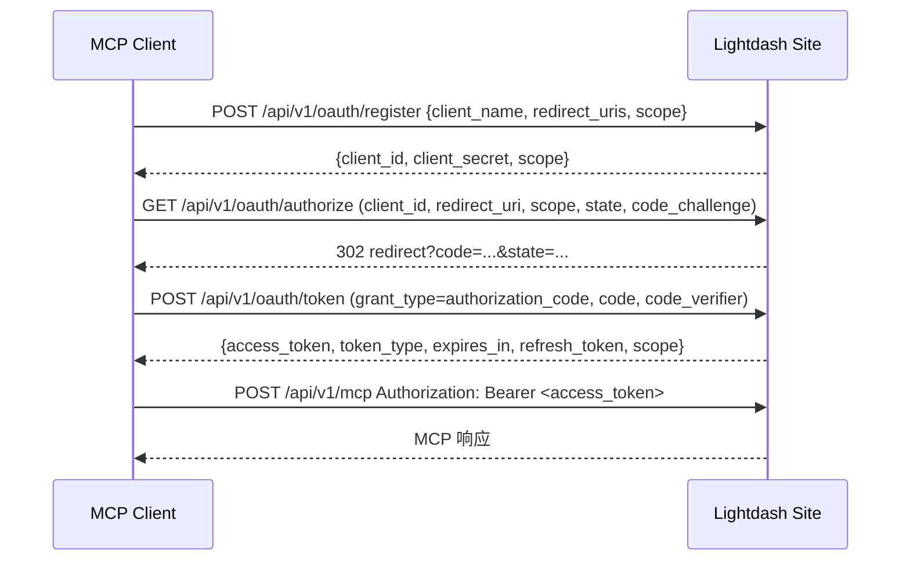

# Lightdash MCP v2（主站统一版）接入指南

> **版本口径**
> - **v1** = 独立包 `packages/lightdash-mcp`（独立进程 + 独立 Docker 镜像 `:port/mcp`，会话式，旁挂式鉴权）→ **已弃用**，去留评估见 [独立包去留评估](./lightdash-mcp-retirement-evaluation.md)。
> - **v2** = **主站内置 MCP**（`https://<site>/api/v1/mcp`，无状态，主站 OAuth + PAT）→ **正式版本，唯一推荐**。
>
> 本文档面向接入方（应用开发者、平台运维）。分析师怎么提问见 [用户使用说明](./lightdash-mcp-user-guide.md)。

---

## 1. 一分钟结论

| | v1（独立包，弃用） | **v2（主站，正式版）** |
|---|---|---|
| 端点 | `http://<host>:<port>/mcp` | **`https://<site>/api/v1/mcp`** |
| 部署 | 独立进程 + 独立镜像 | 跟随主站发布，**不用再部署任何东西** |
| 鉴权 | PAT（服务端代验 OAuth） | **主站 OAuth（`mcp:read`/`mcp:write` scope 校验）+ PAT** |
| 调用身份 | 服务端那把 PAT 的主人 | **调用者本人**（逐用户 CASL 鉴权） |
| 会话 | `Mcp-Session-Id`（内存 TTL/LRU/容量） | **无状态**，不返回也不需要 session 头 |
| 项目上下文 | 进程内存（按 PAT 隔离，重启丢） | **PG `mcp_context`**（按 user+org 隔离，重启不丢、跨副本一致） |
| 错误 | HTTP 往返后压平成文本 | 原生错误直接传播（`ForbiddenError` / `ParameterError` …） |
| 工具 | 26 个 | **26 个（同名同义，参数与返回结构已对齐）** |
| 观测 | stdout 日志 | `mcp_tool_call` 埋点（user/org/project/authType/duration/success）+ 结构化日志 + `/health` |

**换到 v2 需要改的只有两件事：URL 和鉴权头。**

---

## 2. 接入（三种方式，任选其一）

### 2.1 方式 A：PAT（最快，改造量最小）

PAT 走主站原生鉴权，**不受 scope 限制**，沿用调用者本人权限。

```jsonc
// .mcp.json（Cursor / Claude Code 等）
{
  "mcpServers": {
    "lightdash": {
      "type": "http",
      "url": "https://your-lightdash-site.com/api/v1/mcp",
      "headers": {
        "Authorization": "ApiKey <你的 PAT>"
      }
    }
  }
}
```

> ⚠️ 主站 PAT 必须用 `Authorization: ApiKey <PAT>`。
> `x-api-key` 头**只在 v1 独立包**里有效，v2 主站不认（主站统一走 OAuth / PAT 两条通道）。

拿到 PAT：Lightdash → 个人设置 → Personal access token。

### 2.2 方式 B：主站 OAuth（推荐给多用户 / 需要 scope 管控的接入）

主站自带完整 OAuth 2.0：**DCR 动态注册 + 授权码（含 PKCE）** + RFC9728 资源元数据，MCP 客户端可直接自动发现。

**发现端点**

| 用途 | URL |
|---|---|
| 授权服务器元数据 | `{site}/api/v1/oauth/.well-known/oauth-authorization-server` |
| 受保护资源元数据 | `{site}/api/v1/oauth/.well-known/oauth-protected-resource` |
| 动态注册（DCR） | `POST {site}/api/v1/oauth/register` |
| 授权 | `GET {site}/api/v1/oauth/authorize` |
| 换 token | `POST {site}/api/v1/oauth/token` |
| 内省 | `POST {site}/api/v1/oauth/introspect` |
| 吊销 | `POST {site}/api/v1/oauth/revoke` |

**流程**



**DCR 请求示例**

```bash
curl -X POST "$SITE_URL/api/v1/oauth/register" \
  -H "Content-Type: application/json" \
  -d '{
    "client_name": "my-mcp-client",
    "redirect_uris": ["http://127.0.0.1:8765/callback"],
    "scope": "mcp:read",
    "grantTypes": ["authorization_code", "refresh_token"]
  }'
# → 201 { "client_id": "...", "client_secret": "...", "scope": "mcp:read" }
```

- 未请求 scope（或请求了不支持的 scope）→ 自动落到默认 `mcp:read`。
- 支持的 scope 只有 `mcp:read` / `mcp:write` 两个，其它会被丢弃。
- PKCE 可选但**建议开启**（`code_challenge_method=S256`）。

**scope 校验**

| scope | 含义 | 当前状态 |
|---|---|---|
| `mcp:read` | 探索/查询类工具 | **全部 26 个工具都是 read** |
| `mcp:write` | 修改内容类工具 | 预留，暂无工具需要 |

- OAuth token 缺 `mcp:read` → **403**（`ForbiddenError`），不是 401。
- 基础准入 scope 由主站配置 `MCP_OAUTH_REQUIRED_SCOPES` 控制（默认 `mcp:read`）。
- **PAT 不做 scope 校验**（PAT 本身绑定用户权限）。

### 2.3 方式 C：curl / 自研 HTTP 客户端

```bash
# 1) initialize（无状态，直接返回 JSON）
curl -X POST "$SITE_URL/api/v1/mcp" \
  -H "Authorization: ApiKey $LDPAT" \
  -H "Content-Type: application/json" \
  -H "Accept: application/json, text/event-stream" \
  -d '{"jsonrpc":"2.0","id":1,"method":"initialize","params":{"protocolVersion":"2025-03-26","capabilities":{},"clientInfo":{"name":"my-client","version":"1.0.0"}}}'

# 2) tools/call（不需要 session 头）
curl -X POST "$SITE_URL/api/v1/mcp" \
  -H "Authorization: ApiKey $LDPAT" \
  -H "Content-Type: application/json" \
  -H "Accept: application/json, text/event-stream" \
  -d '{"jsonrpc":"2.0","id":2,"method":"tools/call","params":{"name":"list_explores","arguments":{"projectUuid":"<PROJECT_UUID>","pageSize":10}}}'
```

要点：
- `tools/list`、`tools/call` 是 **JSON-RPC method**，写在 `POST /api/v1/mcp` 的 body 里，**不是 URL 路径**。
- `POST` 必须带 `Accept: application/json, text/event-stream`，否则 SDK 会拒（406）。
- 响应是 JSON（`enableJsonResponse: true`），不是 SSE 帧。
- `GET /api/v1/mcp` 打开的是 SSE 心跳流，可选。
- `DELETE /api/v1/mcp` 可用但无副作用（没有服务端会话要释放）。

---

## 3. 无状态与项目上下文

> 🟡 **P8 规划中**：本节描述的是**当前实现**。P8 将把项目上下文语义从「当前项目」收敛为「默认项目」，并把解析链从 2 级扩展为 4 级（显式参数 → 用户级默认 → 组织级默认 → 部署级默认），同时逐级回落。工具名与入参不变。规划见 [`mcp-unified-backend-status.md` §4](./mcp-unified-backend-status.md)。

### 3.1 无状态

v2 **不返回也不接受** `Mcp-Session-Id`。每个请求自带全部信息，因此：

- 主站多副本、滚动发布都不影响；不存在「会话过期 404」这类错误。
- 客户端若强制要求 session 头，需关闭该依赖（多数标准 MCP 客户端本来就支持无 session 模式）。

### 3.2 项目上下文解析顺序

所有需要项目的工具，统一按下面顺序解析：

1. **工具参数里的显式 `projectUuid`**（最高优先级）
2. **当前用户在该组织的「当前项目」**（PG `mcp_context`，按 `user_uuid + organization_uuid` 隔离）
3. 都没有 → 抛 `ForbiddenError`：
   `No project context set. Use set_project or provide projectUuid parameter.`

配套工具：

| 工具 | 作用 |
|---|---|
| `list_projects` | 列出当前用户可见的项目 |
| `set_project` | 设置当前用户 + 当前组织的默认项目（只改上下文，不改内容） |
| `get_current_project` | 读回当前项目 |

> 上下文按**用户**隔离：A 用户 `set_project` 不会影响 B 用户。
> 因为存在数据库里，**重启不丢、跨设备一致**（v1 是进程内存，重启即丢）。

**最佳实践**：自动化 / 跨副本场景，永远显式传 `projectUuid`；`set_project` 只作为人工交互的便利手段。

---

## 4. 工具清单（26 个，全部 `mcp:read`）

| 分组 | 工具 |
|---|---|
| 站点与权限 | `get_site_info`、`get_lightdash_version`、`get_my_access` |
| 项目上下文 | `list_projects`、`set_project`、`get_current_project` |
| 目录 / 元数据 | `find_explores`、`list_explores`、`find_fields`、`search_field_values` |
| 内容检索 | `find_content`、`find_spaces`、`find_charts`、`find_dashboards` |
| 内容列表 | `list_spaces`、`list_dashboards`、`list_charts`、`list_verified_content` |
| 已保存内容 | `get_saved_chart`、`run_saved_chart`、`get_dashboard_tiles`、`run_dashboard_tiles`、`get_dashboard_code` |
| 指标查询 | `run_metric_query`、`run_semantic_metric_query` |
| 文档 | `get_mcp_docs` |

`get_mcp_docs` 可以在会话内直接问「怎么连、怎么查」，返回内置静态文档。

> `list_verified_content`：若当前部署**没有** content-verification 能力，会返回结构化「不支持」响应（`supported: false` + 提示改用 `list_charts` / `list_dashboards`），不会伪造数据。

---

## 5. 健康检查与观测

```bash
curl -s "$SITE_URL/api/v1/mcp/health"
# {"status":"ok","version":"...","stateless":true}
```

- `status`：`ok` / `disabled`（`MCP_ENABLED` 未开或用户无权限）/ `error`。
- 该端点**不需要 MCP 会话**，适合探活与 LB 检查。

工具调用埋点：`mcp_tool_call` 事件含 `toolName`、`user`、`organization`、`project`、`authType`（`oauth`/`pat`）、`durationMs`、`success`；scope 拒绝发生在埋点之前，因此不会计入工具调用。

---

## 6. 从 v1（独立包）迁移到 v2

### 6.1 差异清单

| 差异点 | v1 | v2 | 迁移动作 |
|---|---|---|---|
| URL | `http://<host>:<port>/mcp` | `https://<site>/api/v1/mcp` | **必改** |
| PAT 头 | `x-api-key` 或 `Authorization: ApiKey` | `Authorization: ApiKey` | **必改**（`x-api-key` 主站不认） |
| OAuth | 独立包代验（旁挂） | 主站原生签发 + scope 校验 | 可选升级 |
| `Mcp-Session-Id` | 必须回传 | 不返回也不需要 | **删掉 session 逻辑** |
| session 错误码 | `mcp_session_missing_header` / `mcp_session_not_found` / `mcp_session_capacity` | 不存在 | 错误处理分支可删 |
| 项目上下文 | 内存，按 PAT 隔离，重启丢 | PG，按 user+org 隔离 | 无需改代码，行为更可靠 |
| 项目解析 | session 项目 → 环境变量 → 参数 | **参数 → 当前项目 → 报错** | 注意顺序变了：显式参数优先 |
| 无项目时 | 可能报错也可能回退 | 明确 `ForbiddenError` | 补错误处理 |
| 身份 | 服务端 PAT 的主人 | 调用者本人 | 权限可能变多/变少，按真实用户算 |
| 错误文案 | 压平文本 | 原生错误（更详细） | 若按文本匹配需回归 |

### 6.2 迁移自查清单

1. URL 改成 `https://<site>/api/v1/mcp`。
2. 鉴权头改成 `Authorization: ApiKey <PAT>`（或 OAuth Bearer）。
3. 客户端里去掉 `Mcp-Session-Id` 的保存与回传逻辑；若客户端强制要求，先确认它是否支持无 session 模式。
4. 删掉针对 `mcp_session_*` 错误码的重试分支。
5. 显式传 `projectUuid`（推荐），别依赖 `set_project` 的跨请求状态。
6. 回归验证链路：
   `get_site_info` → `list_projects` → `set_project` / `get_current_project` → `list_explores` → `run_semantic_metric_query` → `find_content` → `run_saved_chart`。
7. 权限变化核对：v1 是「服务端 PAT 的权限」，v2 是「调用者本人的权限」，权限差异会导致可见项目/图表不同。

---

## 7. 配置与运维

| 配置项 | 默认 | 说明 |
|---|---|---|
| `MCP_ENABLED` | 关 | MCP 总开关；也可由 AiCopilot feature flag 单独放开 |
| `MCP_OAUTH_REQUIRED_SCOPES` | `mcp:read` | OAuth 访问 MCP 所需的基础 scope（逗号分隔） |

- MCP 是否可用：`MCP_ENABLED=true` **或** 当前用户命中 AiCopilot feature flag；都不满足时 `/api/v1/mcp` 返回 403、`/health` 返回 `disabled`。

- 无需为 MCP 单独部署进程 / 镜像 / 端口。
- 多副本天然一致（上下文在 PG，无内存态）。
- OAuth client 的 scope 由 DCR 写入；历史 client 通过迁移 `20261012090000_add_mcp_read_scope_to_oauth_clients.ts` 补齐 `mcp:read`。

---

## 8. 排错

| 现象 | 原因 | 处理 |
|---|---|---|
| `401` + `WWW-Authenticate: Bearer resource_metadata="..."` | 没带凭据 / 凭据无效 / PAT 通道被关 | 加 `Authorization` 头；按 `WWW-Authenticate` 里的元数据地址走 OAuth 发现流程 |
| `403` | OAuth token 缺 `mcp:read`，或 MCP 未启用（`MCP_ENABLED` + AiCopilot flag 都不满足） | 补 scope；检查开关 |
| `406 Not Acceptable` | `POST` 少了 `Accept: application/json, text/event-stream` | 补请求头 |
| `No project context set. Use set_project or provide projectUuid parameter.` | 没有当前项目也没传参 | 先 `list_projects` → `set_project`，或直接传 `projectUuid` |
| `404 Session not found` | 客户端还在用 v1 的 session 逻辑 | 去掉 `Mcp-Session-Id` |
| 工具报权限不足 | 真实用户权限不足（v2 按调用者本人算） | 用 `get_my_access` 看能力；或换 PAT |
| `list_verified_content` 返回 `supported: false` | 部署未启用 content-verification | 改用 `list_charts` / `list_dashboards` |

---

## 9. 相关文档

| 文档 | 给谁 |
|---|---|
| 本文档 | 接入方（v2 正式版接入） |
| [独立包去留评估](./lightdash-mcp-retirement-evaluation.md) | 决策者（v1 去留） |
| [统一后端方案](./mcp-unified-backend-plan.md) | 研发（架构与阶段） |
| [工具迁移契约](./mcp-tool-porting-guide.md) | 研发（新增工具怎么写） |
| [用户使用说明](./lightdash-mcp-user-guide.md) | 分析师（怎么提问） |
| [工具与权限对照](./mcp-tools-permissions.md) | 各工具最低项目角色 |
